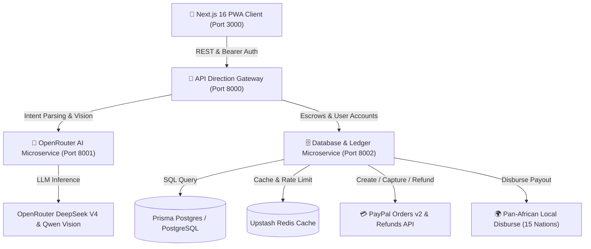
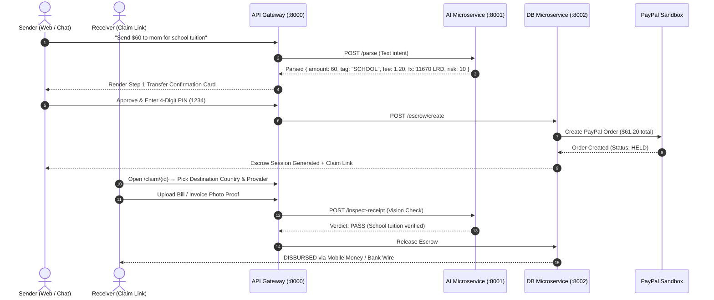

# Ezri Africa — Proof Before Payout Platform

> **Purpose-Locked P2P Remittance & Pan-African AI Escrow Infrastructure.**
> Talk → Lock → Pay → **Prove Before Payout**.
> PayPal collects foreign remittance in US/EU; OpenRouter AI guards every transaction step; Mobile Money Wallets, Commercial Banks & Virtual Cards disburse funds locally across 15 African nations.

**Live demo:** <https://ezri-africa.com> · **API:** <https://api.ezri-africa.com> (health check `/api/health`)


---

## Why Ezri Exists (The Problem & Solution)

1. **The Payout Rail Gap:** Liberians and citizens across multiple African nations **cannot receive PayPal payouts locally** — their countries are omitted from PayPal's supported receiving list. Diaspora senders want to use PayPal, but receivers have no direct local bank link.
2. **The Purpose & Trust Gap:** "Send money for school tuition" too often gets diverted to unrelated expenses. Traditional remittances arrive as cash with **no proof of purpose**.
3. **The Multi-Country Bridge:** PayPal collects in foreign markets (real sandbox escrow) → OpenRouter AI locks the funds to a **purpose tag** (`SCHOOL`, `FOOD`, `HEALTH`, `RENT`, `EMERGENCY`) → receiver proves with an **invoice/receipt photo before release** → instant local disburse via **Mobile Money Wallets, Commercial Banks, or Ezri Virtual Cards**.

---

## System Architecture Diagram



---

## Sub-Directory Documentation Index

- 🌐 [**Web Frontend README (`web/README.md`)**](./web/README.md) — Next.js 16 PWA, full-bleed AI chat, PNG canvas receipts, virtual card vault, claim hub.
- 🔀 [**API Direction Gateway README (`backend/gateway/README.md`)**](./backend/gateway/README.md) — Reverse proxy, CORS, route routing, multi-service health checks.
- 🤖 [**AI Microservice README (`backend/ai-service/README.md`)**](./backend/ai-service/README.md) — OpenRouter DeepSeek V4 intent parsing, Qwen Vision receipt check, risk scoring.
- 🗄️ [**Database Microservice README (`backend/db-service/README.md`)**](./backend/db-service/README.md) — Prisma Postgres schema, SQLite fallback, Upstash Redis caching.
- ⚡ [**Monolithic Backend README (`api/README.md`)**](./api/README.md) — Direct monolithic FastAPI server, MCP agent tools, Zapier webhooks.

---

## Sequence Diagram (End-to-End Remittance Flow)



---

## Complete API Reference & Endpoints

### 1. Gateway & Auth Endpoints (`:8000`)
- `GET /api/health` — Gateway status: `mock_paypal`, `db` (`postgres` or `sqlite`), `ai_guard` (`openrouter` or `heuristic`), `expiry_minutes`, `fee_pct`, `fx_lrd`, `notify_webhook`.
- `POST /api/auth/signup` — Registers user with name, email, profile fields (phone, country, provider, region, DOB, location) and PBKDF2 hashed password.
- `POST /api/auth/login` — Password sign-in.
- `POST /api/auth/demo` — Issues a judge demo token without rejecting credentials.
- `POST /api/auth/otp/request` — Sends a 6-digit sign-in code to the email. Demo mode returns the code on screen; Zapier/webhook delivery when configured.
- `POST /api/auth/otp/verify` — Verifies the code and opens a sender session (creates the account on first use).
- `POST /api/auth/forgot` — Creates a single-use password reset link without revealing whether the account exists.
- `POST /api/auth/reset` — Completes the reset with a valid one-time token.
- `GET /api/auth/me` — Fetches active user session identity plus the saved profile.
- `GET /api/profile` / `POST /api/profile` — Reads and updates sender profile fields.

### 2. AI Copilot & Vision Endpoints (`:8001`)
- `POST /api/chat/parse` — Parses prompt text via OpenRouter DeepSeek V4.
- `POST /api/escrow/prove` — Submits receipt photo file to Qwen Vision AI for strict verification against purpose tags.

### 3. Escrow Lifecycle & Financial Ledger Endpoints (`:8002`)
- `POST /api/escrow/create` — Creates purpose-locked escrow record in database and PayPal Orders v2.
- `POST /api/escrow/capture` — Captures PayPal order payment into escrow balance.
- `POST /api/escrow/override` — Sender manual override with 4-digit money PIN.
- `POST /api/escrow/refund` — Calls PayPal Payments Refunds API to return `amount + fee`.
- `GET /api/escrow/{id}` — Fetches escrow session state for receiver claim page.
- `GET /api/dashboard` — Lists financial ledger transactions with natural language query filtering.

### 4. Vault, Preferences & Automation (`:8002`, persisted per sender)
- `GET /api/cards` · `POST /api/cards/create` · `POST /api/cards/freeze` · `POST /api/cards/topup` · `POST /api/cards/delete` — Virtual card vault (max 3 per sender; deterministic mock Visa/Mastercard numbers, balances and freeze state survive redeploys with `DATABASE_URL`).
- `GET /api/prefs` · `POST /api/prefs` — Purpose-lock configuration saved server-side; localStorage stays the offline fallback.
- `GET /api/events` — Last 25 lifecycle events plus whether `NOTIFY_WEBHOOK_URL` is configured (rendered in Settings → Automation & webhooks).

---

## Database Entity Schema (Prisma Postgres)

```prisma
datasource db {
  provider = "postgresql"
  url      = env("DATABASE_URL")
}

model Escrow {
  id              String   @id                          // EZR-XXXXXXXX
  amountUsd       Float    @map("amount_usd")          // $ Amount
  feeUsd          Float    @default(0) @map("fee_usd") // Ezri 2% Fee
  tag             String                                // SCHOOL, FOOD, HEALTH, RENT, EMERGENCY
  note            String   @default("")
  recipient       String   @default("mom")
  status          String   @default("DRAFT")           // DRAFT, HELD, RELEASED, REFUNDED, EXPIRED
  paypalOrderId   String   @default("") @map("paypal_order_id")
  paypalCaptureId String   @default("") @map("paypal_capture_id")
  provider        String   @default("")                // MTN, Orange, Ecobank, Wave, M-Pesa, OPay
  providerNumber  String   @default("") @map("provider_number")
  verdict         String   @default("")                // PASS / FAIL
  verdictReason   String   @default("") @map("verdict_reason")
  mockMomoTxnId   String   @default("") @map("mock_momo_txn_id")
  senderEmail     String   @default("") @map("sender_email")
  createdAt       Float    @map("created_at")
  expiresAt       Float    @map("expires_at")

  @@map("escrows")
}

model User {
  email     String   @id
  name      String   @default("")
  pwHash    String   @map("pw_hash")
  createdAt Float    @map("created_at")

  @@map("users")
}

model Session {
  token     String   @id
  email     String
  createdAt Float    @map("created_at")

  @@map("sessions")
}

model VirtualCard {
  id         String   @id                          // CARD-XXX
  userEmail  String   @map("user_email")
  name       String
  number     String                                // Visa/Mastercard digits
  expiry     String
  cvv        String
  balance    Float    @default(100.0)
  frozen     Boolean  @default(false)
  type       String   @default("Visa")
  createdAt  Float    @map("created_at")

  @@map("virtual_cards")
}
```

---

## Why this Architecture? (Technical Justifications)

1. **Decoupled Microservices**: Isolating `ai-service` from `db-service` ensures that heavy LLM inference latencies or external API limits on OpenRouter never block database queries or payment webhooks.
2. **Zero-Key Fallback Resilience**: Every microservice includes rule-based fallbacks. If `OPENROUTER_API_KEY` or `PAYPAL_CLIENT_ID` are unset, the app falls back to deterministic rule engines and mock PayPal sandbox IDs without breaking or throwing errors.
3. **Prisma Postgres + SQLite Dual Engine**: Production connects to high-availability Prisma Postgres (`DATABASE_URL`), while local development automatically falls back to lightweight SQLite (`ezri.db`).
4. **Upstash Redis Acceleration**: Caches live exchange rates and session tokens to maintain sub-50ms response times on client requests.

---

## Pan-African Local Coverage (15 Countries)

- 🇱🇷 **Liberia**: MTN MoMo, Orange Money, Ecobank, UBA, GTBank (LRD / USD Dual Currency)
- 🇬🇭 **Ghana**: MTN MoMo, Telecel Cash, AT Money, Ecobank Ghana, GCB
- 🇳🇬 **Nigeria**: OPay, PalmPay, Moniepoint, Access Bank, Zenith Bank, GTBank, UBA
- 🇸🇳 **Senegal & WAEMU**: Wave Mobile Money, Orange Money WA, Free Money, Ecobank
- 🇰🇪 **Kenya**: M-Pesa (Safaricom), Airtel Money, KCB Bank, Equity Bank
- 🇿🇦 **South Africa**: Capitec Pay, VodaPay, FNB, Standard Bank
- 🇨🇮 **Côte d'Ivoire**: Orange Money CI, Wave CI, MTN CI
- 🇹ℤ **Tanzania**: M-Pesa TZ, Tigo Pesa, CRDB Bank
- 🇺🇬 **Uganda**: MTN MoMo UG, Airtel Money UG
- 🇷🇼 **Rwanda**: MTN MoMo RW, Airtel Money RW
- 🇪🇹 **Ethiopia**: Telebirr, CBE Birr
- 🇪🇬 **Egypt**: Vodafone Cash, InstaPay
- 🇿🇼 **Zimbabwe**: EcoCash, InnBucks (ZiG / USD)
- 🇸🇱 **Sierra Leone**: Orange Money SL, Africell Money
- 🇬🇲 **Gambia**: QMoney, AfriMoney Gambia

---

## Environment Variables (All Keys)

Nothing is mandatory: with zero keys the app still runs the complete judge demo
(mock PayPal, SQLite, heuristic AI guard, sign-in codes shown on screen). The
keys below make each integration real.

Local templates (both gitignored; the templates are committed):

```powershell
Copy-Item .env.example .env                 # API gateway keys
Copy-Item web/.env.example web/.env.local   # Next.js web keys
```

The API loads the repo-root `.env` automatically (`api/env_loader.py`,
python-dotenv) **without overriding** real process env, so Render dashboard
values always win. `GET /api/health` reports what was actually picked up:

```json
{"ok":true,"mock_paypal":false,"db":"postgres","ai_guard":"openrouter",
 "expiry_minutes":10,"fee_pct":0.02,"fx_lrd":194.5,"notify_webhook":true}
```

### API gateway (`ezri-api` on Render)

| Variable | Needed? | What it does | Where to get it | Without it |
|---|---|---|---|---|
| `DATABASE_URL` | Recommended | Postgres persistence for users, sessions, escrows, cards, prefs, OTPs, reset tokens, and events | [Neon](https://neon.tech): create a free project, then Dashboard -> Connect -> copy the pooled connection string and add `?sslmode=require` if it is not already there. Prisma Postgres works too. | SQLite at `api/ezri.db`; data resets on every Render redeploy |
| `DATABASE_URL_UNPOOLED` | No | Direct Neon URL used only for one-time schema initialization | The Neon CLI writes it automatically (`neon env pull`) | Schema init runs over the pooled URL (works, but less ideal) |
| `PAYPAL_CLIENT_ID` | Optional | PayPal Orders v2 sandbox OAuth | [PayPal Developer Dashboard](https://developer.paypal.com/dashboard/applications/sandbox): Apps & Credentials -> Sandbox -> Create App -> copy Client ID | Mock PayPal (`MOCK-` order/capture ids, mock approval page) |
| `PAYPAL_CLIENT_SECRET` | Optional | Secret for the same PayPal sandbox app | Same screen as the Client ID | Mock PayPal |
| `PAYPAL_BASE_URL` | No | PayPal API host | Default `https://api-m.sandbox.paypal.com`; use `https://api-m.paypal.com` only for live money | Sandbox host |
| `OPENROUTER_API_KEY` | Optional | LLM intent parsing: amount, purpose tag, and recipient extraction | [OpenRouter Keys](https://openrouter.ai/keys): Create Key, copy `sk-or-v1-...`, add a few dollars of credit | Deterministic heuristic guard (receipt proof is deterministic either way) |
| `OPENROUTER_MODELS` | No | Comma-separated fallback chain, tried in order | Default `deepseek/deepseek-chat,qwen/qwen-2.5-72b-instruct` | Default chain |
| `OPENROUTER_SITE_URL` | No | Attribution header sent to OpenRouter | Default `https://ezri-africa.com` | Default |
| `OPENROUTER_SITE_NAME` | No | Attribution label sent to OpenRouter | Default `Ezri Africa hackathon demo` | Default |
| `NOTIFY_WEBHOOK_URL` | Optional | Zapier Catch Hook: lifecycle events, OTP codes, and password-reset links | [Zapier](https://zapier.com): Create Zap -> Trigger `Webhooks by Zapier` -> `Catch Hook` -> copy the hook URL | OTP/reset codes are returned on screen as `demo_code` / `demo_token`; events stay in the API log |
| `DEMO_EXPIRY_MINUTES` | No | Escrow expiry window | Default `10` (demo stand-in for the 48h production policy) | 10 |
| `EZRI_FEE_PCT` | No | Platform fee added on top of the transfer | Default `0.02` (2%) | 0.02 |
| `EZRI_MONEY_PIN` | No | PIN required by the MCP money-moving tools | Default `1234` (demo only) | 1234 |
| `WEB_BASE_URL` | No | Base URL used inside reset links delivered to the webhook | Default `https://ezri-africa.com` | Default |
| `CORS_ALLOWED_ORIGINS` | No | Comma-separated browser origins allowed to call the API | Production defaults are baked into `server.py`; set locally to include the dev-server origin | Production origins |
| `EZRI_DB` | No | Override the SQLite file path | Local development only | `api/ezri.db` |

Webhook payloads are flat JSON: `event` plus `email` and `code` for
`auth.otp_requested`; `event` plus `email` and `reset_url` for
`auth.reset_requested`; escrow fields (`escrow_id`, `status`, `tag`,
`amount_usd`, `verdict`, ...) for transfer and proof events.

PayPal account type: use a normal PayPal Developer login (a personal account is
fine) to create the sandbox app. The money is received by a sandbox **Business**
account, which the dashboard creates for you. Going live with real payments
requires a PayPal **Business** account; the hackathon demo stays in sandbox.

Reserved but not read by current code: `REDIS_URL`, `UPSTASH_REDIS_REST_URL`,
`UPSTASH_REDIS_REST_TOKEN`, `CLOUDFLARE_R2_ACCOUNT_ID`,
`CLOUDFLARE_R2_ACCESS_KEY_ID`, `CLOUDFLARE_R2_SECRET_ACCESS_KEY`,
`CLOUDFLARE_R2_BUCKET_NAME`.

### Web (`ezri-web` / Next.js)

`NEXT_PUBLIC_*` values are inlined at build/dev start, so set them before the
build and restart `pnpm dev` after any change.

| Variable | Needed? | What it does | Where to get it | Without it |
|---|---|---|---|---|
| `NEXT_PUBLIC_API_URL` | Recommended | API base the browser calls | `https://api.ezri-africa.com` in production; the local gateway origin (port 8000) in `web/.env.local` | Code falls back to `https://api.ezri-africa.com` |
| `NEXT_PUBLIC_PAYPAL_CLIENT_ID` | Optional | Public client ID for browser-side PayPal buttons | The same sandbox app's Client ID (public by design) | App uses the mock checkout path |

### Where to put the production values

- **Render `ezri-api`** -> Environment: `DATABASE_URL`, `PAYPAL_CLIENT_ID`,
  `PAYPAL_CLIENT_SECRET`, `OPENROUTER_API_KEY`, `NOTIFY_WEBHOOK_URL`. Save and
  Render redeploys automatically.
- **Render `ezri-web`** -> Environment: `NEXT_PUBLIC_PAYPAL_CLIENT_ID` (and
  `NEXT_PUBLIC_API_URL` if the domain ever changes). Use **Clear build cache &
  deploy** so the value is inlined into the bundle.
- **GitHub repo variables** (only for the GHCR image workflow): add
  `NEXT_PUBLIC_API_URL` and `NEXT_PUBLIC_PAYPAL_CLIENT_ID` under
  Settings -> Secrets and variables -> Actions -> Variables.
- Never commit real values. `.env`, `.env.*`, and `web/.env.local` are ignored
  by git; only the `*.env.example` templates are tracked.

### Minimum path to a fully live demo

1. Neon `DATABASE_URL` -> persistence across redeploys.
2. PayPal sandbox Client ID + Secret -> real sandbox orders (no real money).
3. OpenRouter key -> real LLM parsing and vision verdicts.
4. Zapier Catch Hook -> real OTP and reset email delivery.
5. `NEXT_PUBLIC_PAYPAL_CLIENT_ID` -> browser PayPal buttons.

---

## Running Locally (Deployed Architecture)

The live demo is two processes: the FastAPI gateway and the Next.js web app.
The `backend/` microservice split (AI on 8001, DB on 8002, proxy on 8000) is
kept as reference architecture and is not required for the demo; see
[`backend/README.md`](./backend/README.md).

```powershell
# Terminal 1 -- API gateway on port 8000
cd api
python -m uvicorn server:app --reload --port 8000

# Terminal 2 -- web app on port 3000
cd web
pnpm dev
```

Copy the env templates first (see [Environment Variables](#environment-variables-all-keys)).
Health check: `https://api.ezri-africa.com/api/health` in production, or the
`/api/health` path on port 8000 locally.

Open the live app at <https://ezri-africa.com/login> and click **"Continue with One-Tap Demo"** (API base: <https://api.ezri-africa.com>).

---

## License

MIT — see [LICENSE](./LICENSE).
