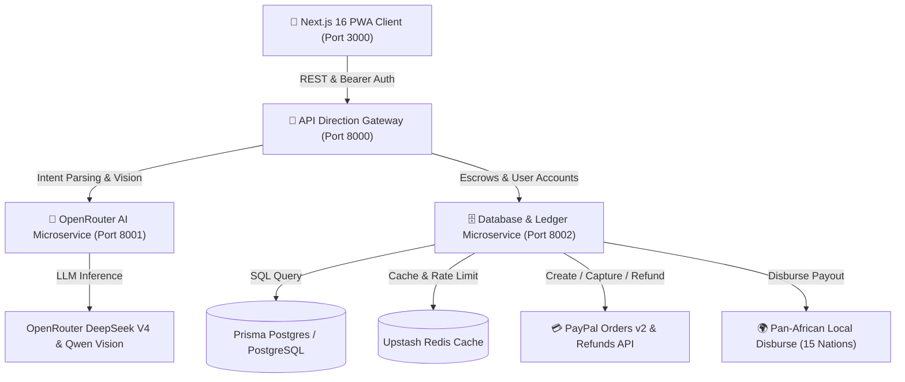
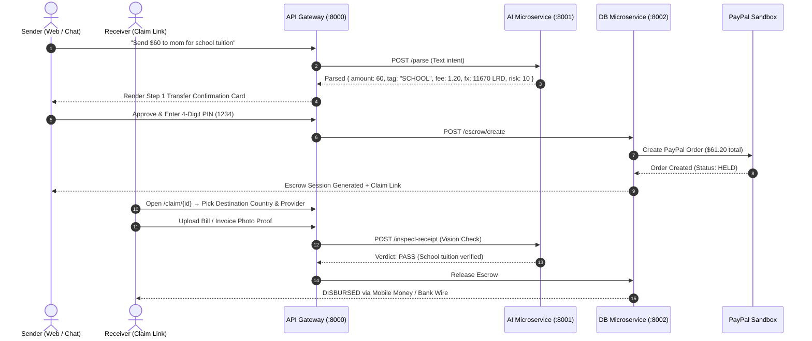

# Ezri Africa — Proof Before Payout Platform

> **Purpose-Locked P2P Remittance & Pan-African AI Escrow Infrastructure.**
> Talk → Lock → Pay → **Prove Before Payout**.
> PayPal collects foreign remittance in US/EU; OpenRouter AI guards every transaction step; Mobile Money Wallets, Commercial Banks & Virtual Cards disburse funds locally across 15 African nations.


---

## Why Ezri Exists (The Problem & Solution)

1. **The Payout Rail Gap:** Liberians and citizens across multiple African nations **cannot receive PayPal payouts locally** — their countries are omitted from PayPal's supported receiving list. Diaspora senders want to use PayPal, but receivers have no direct local bank link.
2. **The Purpose & Trust Gap:** "Send money for school tuition" too often gets diverted to unrelated expenses. Traditional remittances arrive as cash with **no proof of purpose**.
3. **The Multi-Country Bridge:** PayPal collects in foreign markets (real sandbox escrow) → OpenRouter AI locks the funds to a **purpose tag** (`SCHOOL`, `FOOD`, `HEALTH`, `RENT`, `EMERGENCY`) → receiver proves with an **invoice/receipt photo before release** → instant local disburse via **Mobile Money Wallets, Commercial Banks, or Ezri Virtual Cards**.

---

## System Architecture Diagram



---

## Sub-Directory Documentation Index

- 🌐 [**Web Frontend README (`web/README.md`)**](./web/README.md) — Next.js 16 PWA, full-bleed AI chat, PNG canvas receipts, virtual card vault, claim hub.
- 🔀 [**API Direction Gateway README (`backend/gateway/README.md`)**](./backend/gateway/README.md) — Reverse proxy, CORS, route routing, multi-service health checks.
- 🤖 [**AI Microservice README (`backend/ai-service/README.md`)**](./backend/ai-service/README.md) — OpenRouter DeepSeek V4 intent parsing, Qwen Vision receipt check, risk scoring.
- 🗄️ [**Database Microservice README (`backend/db-service/README.md`)**](./backend/db-service/README.md) — Prisma Postgres schema, SQLite fallback, Upstash Redis caching.
- ⚡ [**Monolithic Backend README (`api/README.md`)**](./api/README.md) — Direct monolithic FastAPI server, MCP agent tools, Zapier webhooks.

---

## Sequence Diagram (End-to-End Remittance Flow)



---

## Complete API Reference & Endpoints

### 1. Gateway & Auth Endpoints (`:8000`)
- `GET /api/health` — Returns multi-service health status (`ai_service_online`, `db_service_online`, `fee_pct`, `fx_lrd`).
- `POST /api/auth/signup` — Registers user with name, email, and PBKDF2 hashed password.
- `POST /api/auth/demo` — Issues a judge demo token without rejecting credentials.
- `GET /api/auth/me` — Fetches active user session identity.

### 2. AI Copilot & Vision Endpoints (`:8001`)
- `POST /api/chat/parse` — Parses prompt text via OpenRouter DeepSeek V4.
- `POST /api/escrow/prove` — Submits receipt photo file to Qwen Vision AI for strict verification against purpose tags.

### 3. Escrow Lifecycle & Financial Ledger Endpoints (`:8002`)
- `POST /api/escrow/create` — Creates purpose-locked escrow record in database and PayPal Orders v2.
- `POST /api/escrow/capture` — Captures PayPal order payment into escrow balance.
- `POST /api/escrow/override` — Sender manual override with 4-digit money PIN.
- `POST /api/escrow/refund` — Calls PayPal Payments Refunds API to return `amount + fee`.
- `GET /api/escrow/{id}` — Fetches escrow session state for receiver claim page.
- `GET /api/dashboard` — Lists financial ledger transactions with natural language query filtering.

---

## Database Entity Schema (Prisma Postgres)

```prisma
datasource db {
  provider = "postgresql"
  url      = env("DATABASE_URL")
}

model Escrow {
  id              String   @id                          // EZR-XXXXXXXX
  amountUsd       Float    @map("amount_usd")          // $ Amount
  feeUsd          Float    @default(0) @map("fee_usd") // Ezri 2% Fee
  tag             String                                // SCHOOL, FOOD, HEALTH, RENT, EMERGENCY
  note            String   @default("")
  recipient       String   @default("mom")
  status          String   @default("DRAFT")           // DRAFT, HELD, RELEASED, REFUNDED, EXPIRED
  paypalOrderId   String   @default("") @map("paypal_order_id")
  paypalCaptureId String   @default("") @map("paypal_capture_id")
  provider        String   @default("")                // MTN, Orange, Ecobank, Wave, M-Pesa, OPay
  providerNumber  String   @default("") @map("provider_number")
  verdict         String   @default("")                // PASS / FAIL
  verdictReason   String   @default("") @map("verdict_reason")
  mockMomoTxnId   String   @default("") @map("mock_momo_txn_id")
  senderEmail     String   @default("") @map("sender_email")
  createdAt       Float    @map("created_at")
  expiresAt       Float    @map("expires_at")

  @@map("escrows")
}

model User {
  email     String   @id
  name      String   @default("")
  pwHash    String   @map("pw_hash")
  createdAt Float    @map("created_at")

  @@map("users")
}

model Session {
  token     String   @id
  email     String
  createdAt Float    @map("created_at")

  @@map("sessions")
}

model VirtualCard {
  id         String   @id                          // CARD-XXX
  userEmail  String   @map("user_email")
  name       String
  number     String                                // Visa/Mastercard digits
  expiry     String
  cvv        String
  balance    Float    @default(100.0)
  frozen     Boolean  @default(false)
  type       String   @default("Visa")
  createdAt  Float    @map("created_at")

  @@map("virtual_cards")
}
```

---

## Why this Architecture? (Technical Justifications)

1. **Decoupled Microservices**: Isolating `ai-service` from `db-service` ensures that heavy LLM inference latencies or external API limits on OpenRouter never block database queries or payment webhooks.
2. **Zero-Key Fallback Resilience**: Every microservice includes rule-based fallbacks. If `OPENROUTER_API_KEY` or `PAYPAL_CLIENT_ID` are unset, the app falls back to deterministic rule engines and mock PayPal sandbox IDs without breaking or throwing errors.
3. **Prisma Postgres + SQLite Dual Engine**: Production connects to high-availability Prisma Postgres (`DATABASE_URL`), while local development automatically falls back to lightweight SQLite (`ezri.db`).
4. **Upstash Redis Acceleration**: Caches live exchange rates and session tokens to maintain sub-50ms response times on client requests.

---

## Pan-African Local Coverage (15 Countries)

- 🇱🇷 **Liberia**: MTN MoMo, Orange Money, Ecobank, UBA, GTBank (LRD / USD Dual Currency)
- 🇬🇭 **Ghana**: MTN MoMo, Telecel Cash, AT Money, Ecobank Ghana, GCB
- 🇳🇬 **Nigeria**: OPay, PalmPay, Moniepoint, Access Bank, Zenith Bank, GTBank, UBA
- 🇸🇳 **Senegal & WAEMU**: Wave Mobile Money, Orange Money WA, Free Money, Ecobank
- 🇰🇪 **Kenya**: M-Pesa (Safaricom), Airtel Money, KCB Bank, Equity Bank
- 🇿🇦 **South Africa**: Capitec Pay, VodaPay, FNB, Standard Bank
- 🇨🇮 **Côte d'Ivoire**: Orange Money CI, Wave CI, MTN CI
- 🇹ℤ **Tanzania**: M-Pesa TZ, Tigo Pesa, CRDB Bank
- 🇺🇬 **Uganda**: MTN MoMo UG, Airtel Money UG
- 🇷🇼 **Rwanda**: MTN MoMo RW, Airtel Money RW
- 🇪🇹 **Ethiopia**: Telebirr, CBE Birr
- 🇪🇬 **Egypt**: Vodafone Cash, InstaPay
- 🇿🇼 **Zimbabwe**: EcoCash, InnBucks (ZiG / USD)
- 🇸🇱 **Sierra Leone**: Orange Money SL, Africell Money
- 🇬🇲 **Gambia**: QMoney, AfriMoney Gambia

---

## Running All Microservices Locally

```bash
# 1. Start AI Microservice (Port 8001)
python backend/ai-service/main.py

# 2. Start DB Microservice (Port 8002)
python backend/db-service/main.py

# 3. Start API Direction Gateway (Port 8000)
python backend/gateway/main.py

# 4. Start Next.js PWA Web App (Port 3000)
cd web && pnpm run dev
```

Open <http://localhost:3000/login> and click **"Continue with One-Tap Demo"**.

---

## License

MIT — see [LICENSE](./LICENSE).
