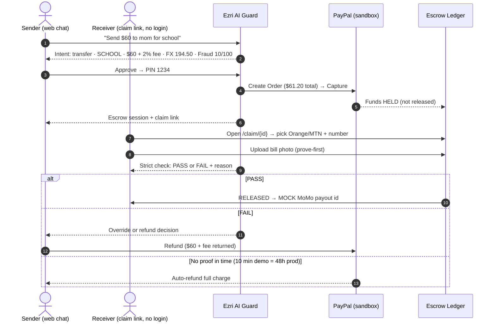

# Ezri Africa — Proof Before Payout

> **Purpose-locked P2P for Africa.** Talk → lock → pay → **prove before payout**.
> PayPal collects where diaspora pay; AI guards every step; mobile money pays out where PayPal can't.


**Built for** the PayPal AI Hackathon (Devpost, deadline Nov 12 2026) · **Pilot** Liberia, **built for all of Africa**

---

## Why Ezri exists

- **The rail gap:** Liberians (and most of West Africa) **cannot receive PayPal payouts locally** — the country isn't on PayPal's supported payout list. Money sent from abroad has nowhere clean to land.
- **The trust gap:** "Send money for school" too often becomes money for anything else. Normal remittances arrive as cash with **no proof of purpose**.
- **The bridge:** PayPal collects in supported markets (real sandbox escrow) → AI locks the funds to a **purpose tag** → receiver proves with a **bill photo before release** → mobile-money payout (MOCK in the contest, clearly labeled) or an **automatic refund**.

Diaspora parents, students paying fees, health emergencies — the money only moves for the reason it was sent.

---

## How it works



### System architecture

```
┌────────────────────────────────────────────────────────────────────────┐
│  web/  — Next.js 16 PWA (App Router, Tailwind 4, Annita One theme)    │
│                                                                        │
│  /login ─ any email+password (demo) · passkey · OTP                    │
│  /      ─ AI chat: intent cards → agent steps → approve → PIN          │
│  /dashboard ─ AG Grid ledger + natural-language filter                 │
│  /purpose-lock ─ tag rules, approval & expiry preferences              │
│  /settings ─ approvals · fees · appearance (theme/text size/font)      │
│  /claim/[id] ─ receiver, no login: provider pick → photo → verdict     │
└──────────────┬─────────────────────────────────────────────────────────┘
               │  fetch (REST + Bearer session)   ·  PayPal JS SDK button
┌──────────────▼─────────────────────────────────────────────────────────┐
│  api/  — FastAPI (Python) + SQLite                                     │
│                                                                        │
│  auth (pbkdf2) · chat intent guard · escrow lifecycle · refunds        │
│  ┌─────────────────┐  ┌──────────────────┐  ┌───────────────────────┐   │
│  │ ai_guard.py     │  │ ledger.py        │  │ paypal_client.py      │   │
│  │ intent + reply  │  │ escrows, fees,   │  │ Orders v2 create/     │   │
│  │ rules (zero-key)│  │ users, proofs    │  │ capture + Refunds     │   │
│  │ LLM refine (opt)│  │ (fee_usd column) │  │ mock when no keys     │   │
│  └─────────────────┘  └──────────────────┘  └───────────┬───────────┘   │
└─────────────────────────────────────────────────────────┼───────────────┘
                                        PayPal sandbox ◄──┘   (webhooks
                                        MoMo = MOCK ──────►    /api/webhooks/paypal)
```

---

## What's inside

### Prove-first escrow (the product)
- **Purpose tags** — `FOOD · SCHOOL · HEALTH · RENT · EMERGENCY · GENERAL`, set from natural language.
- **Strict verdict** — receiver must upload a bill photo; the guard requires a real file **and** tag keyword match → **PASS/FAIL with reason**. FAIL offers retry, **sender override** (human-in-loop) or refund.
- **Auto-refund** — unproven/expired escrow refunds **amount + 2% fee** automatically (10-minute demo clock shown as *48h production*).
- **Always visible money math** — 2% platform fee added on top (sender pays `amount + fee`, receiver gets the full amount) and FX standardized at **1 USD = 194.50 LRD** everywhere: chat cards, ledger, claim page, settings.

### AI that asks before it acts
- Rule-first intent classifier (works with **zero keys**) returns `transfer | needs_amount | greeting | fees | escrow | help | status | chat` — chat shows money cards **only** on a real transfer intent; it never invents one.
- The agent runs a visible pipeline (live terminal card in chat): parse → fraud score → FX → fee → **stop for approval** → **PIN (demo `1234`)** → execute. No action runs without both gates.
- Optional LLM refinement via OpenRouter (`OPENROUTER_API_KEY`) on top of the rules — demo runs fully offline without it.
- Voice in/out (Web Speech STT/TTS), conversation replies + suggestion chips for non-transfer messages.

### Auth judges can actually run
- Sign-in: **any email + password opens the demo session** (also passkey button and email-code OTP) — no Company ID field anywhere.
- Sign-up asks **phone, country, date of birth, location** + confirm-password.
- Receiver side never logs in — the claim link is the identity.

### Design: Annita One, mobile-first, light & dark
- Design tokens copied verbatim from the internal **Annita One** app; same flow from sign-in to AI chat.
- **Token-driven dark mode** — one `[data-theme=dark]` token swap re-themes every surface, brand tint, and status color; no per-element exceptions.
- **Fluid typography** — every size is a `clamp()` token between 320px→1440px viewports multiplied by a user scale; **zero hard-coded pixel font sizes**.
- **Adjustable from Settings → Appearance** — theme (System/Light/Dark), text size (Compact/Default/Big/Extra large), font (Default/Legible/Monospace), high contrast, simple language — applied before first paint (no flash) and persisted per device.
- Mobile-first grids stack before they jam; 4-item bottom nav, sidebar on wide screens, safe-area aware, `prefers-reduced-motion` respected, keyboard + screen-reader labeled.

### Ledger & visibility
- AG Grid transfers ledger with **natural-language filtering** ("show risky sends?"), status pills, fee columns and KPIs.
- Claim hub + claim detail pages, purpose-lock configuration, full app settings.

---

## Tech stack

| Layer | Choice | Notes |
|---|---|---|
| Web framework | **Next.js 16.4** (App Router, Turbopack) | `@tailwindcss/turbopack` |
| UI | **React 19.3** · **Tailwind CSS 4.3** · lucide-react | Design tokens in `globals.css` |
| Language | **TypeScript 5.9** | `pnpm run typecheck` clean |
| Data/validation | zod 4 · idb-keyval (offline outbox) | AG Grid 32 for the ledger |
| API | **FastAPI 0.115** + Uvicorn · Pydantic 2 · httpx | `python-multipart` for photo prove |
| Store | **SQLite** (file) | escrows, users, proofs; `pytest` suite |
| Payments | **PayPal Orders v2** create/capture · **Refunds** · Webhooks | Mock mode when keys unset |
| AI | Rule-first intent/fraud/proof guard · optional OpenRouter LLM | Voice: Web Speech API |
| Package mgmt | **pnpm 12.4.1** | lockfile committed |
| Deploy | **Render** (`render.yaml`) · GitHub Actions-ready | MIT licensed |

---

## Getting started (judges: zero keys needed)

```bash
# 1 — API (FastAPI, mock PayPal + rule AI work offline)
cd api
pip install -r requirements.txt
pytest -q                      # vertical-slice suite
uvicorn server:app --port 8000 # → http://127.0.0.1:8000/api/health

# 2 — Web (new terminal)
cd web
pnpm install
pnpm run dev                   # → http://localhost:3000
```

Open <http://localhost:3000/login> — **enter any email and password** to land in the demo.

Optional real keys: copy `.env.example` → `api/.env` and set `PAYPAL_CLIENT_ID`, `PAYPAL_SECRET`, `NEXT_PUBLIC_PAYPAL_CLIENT_ID` (sandbox) and `OPENROUTER_API_KEY` (LLM). Without them everything runs in clearly-labeled mock mode.

---

## Environment variables

| Variable | Where | Default | Purpose |
|---|---|---|---|
| `PAYPAL_CLIENT_ID` / `PAYPAL_SECRET` | api | — (mock) | PayPal sandbox credentials |
| `PAYPAL_BASE_URL` | api | `https://api-m.sandbox.paypal.com` | Orders/Refunds base |
| `NEXT_PUBLIC_PAYPAL_CLIENT_ID` | web (build) | — (mock) | Embedded approval button |
| `NEXT_PUBLIC_API_URL` | web (build) | `http://localhost:8000` | API base for the browser |
| `CORS_ALLOWED_ORIGINS` | api | includes `localhost:3000` in dev | Allowed origins |
| `EZRI_FEE_PCT` | api | `0.02` | 2% platform fee, added on top |
| `DEMO_EXPIRY_MINUTES` | api | `10` | Demo escrow clock (48h in prod) |
| `OPENROUTER_API_KEY` | api | — (rules only) | LLM intent refinement |
| `EZRI_FX_LRD` | api/web | `194.50` | Standardized USD→LRD rate |

---

## API reference

| Method & path | Purpose |
|---|---|
| `POST /api/auth/signup` · `POST /api/auth/login` · `POST /api/auth/demo` | Account creation, login, **any-credential demo session** |
| `GET /api/auth/me` | Session identity |
| `GET /api/health` | Version, `mock_paypal`, `fee_pct`, `fx_lrd` |
| `POST /api/chat/parse` | Intent + reply + parsed tag/amount/fraud/fee |
| `POST /api/escrow/create` | Create escrow (fee-charged total, PayPal order) |
| `POST /api/escrow/capture` | Capture funds → HELD |
| `POST /api/escrow/prove` | Multipart photo + provider pick → PASS/FAIL + reason |
| `POST /api/escrow/override` | Sender override after FAIL |
| `POST /api/escrow/refund` | Refund amount + fee |
| `GET /api/escrow/{id}` | Escrow state for chat/claim page |
| `POST /api/webhooks/paypal` | Sandbox webhook receiver |
| `GET /api/dashboard?q=` | Ledger rows + natural-language filter |

**Postman:** `postman/ezri-africa.postman_collection.json` — set `{{base}}` to the hosted API to replay the judge flow.

---

## Pages

| Route | Audience | What happens |
|---|---|---|
| `/login`, `/signup`, `/verify-otp` | Sender | Any-credential demo, passkey, OTP, full signup fields |
| `/` | Sender | AI chat: 3-step cards, live agent terminal, approve → PIN gates |
| `/dashboard` | Sender | AG Grid ledger, KPIs with fees, NL filter, refund/override actions |
| `/purpose-lock` | Sender | Tag rules, approval prefs, expiry, fees & limits |
| `/settings` | Sender | Account, approvals, fees, appearance (theme/text/font), notifications |
| `/claim`, `/claim/[id]` | **Receiver (no login)** | Transfer details, provider pick, bill photo, PASS/FAIL, safety rules |

---

## Demo day

```bash
cd api && python seed_demo.py   # clean ledger: 1 RELEASED + 1 NEEDS_RETRY
```

- **Demo PIN:** `1234` (everywhere — chat, refunds, overrides).
- **Fee:** 2% added on top → `$60 → $1.20 fee → $61.20 charged → receiver gets $60 (11,670 LRD)`.
- **Thumbnail:** `assets/make_thumbnail.py` → `assets/thumbnail.png` (1200×800, upload to Devpost).
- **Video:** <3 min script in `../ONE_PAGE_PLAN.md` — talk → lock → pay → hold → prove PASS + FAIL → MoMo mock → refund.

## Testing

```bash
cd api && pytest -q            # vertical slice: auth, intent, escrow, prove, refund, fees
cd web && pnpm run typecheck   # tsc --noEmit
cd web && pnpm run lint        # eslint
cd web && pnpm run test        # vitest
cd web && pnpm run build       # production build (14 routes)
```

## Deployment

`render.yaml` defines both services (`ezri-api`, `ezri-web`, pnpm frozen lockfile). After the first deploy set in the Render dashboard:

1. `NEXT_PUBLIC_API_URL=https://ezri-api.onrender.com` (baked at web build time)
2. `CORS_ALLOWED_ORIGINS=https://ezri-web.onrender.com`
3. Optional: PayPal sandbox keys + `OPENROUTER_API_KEY`

## Devpost resources & tracks

- **PayPal:** REST Orders v2 + Payments Refunds (sandbox), Checkout approval link, Webhooks receiver, Developer Dashboard.
- **Sponsors:** AG Grid (live ledger + ask-filter), Render (hosting), Postman (collection). Others (Channel3/Bryntum/Elastic/APIMatic/Astropods/KERNEL/Zapier) skipped deliberately — no fit for prove-first P2P.
- **Tracks:** **Social Impact** first (inclusion + accessibility), **Money Movement** second.

## Roadmap

Real Orange/MTN MoMo rails behind the same escrow API · WhatsApp claim surface · French/Pidgin locale packs (Annita `en/fr/zh` key pattern) · Qwen vision receipt model in production · pooled merchant accounts + licensing.

## License

MIT — see [LICENSE](./LICENSE).
